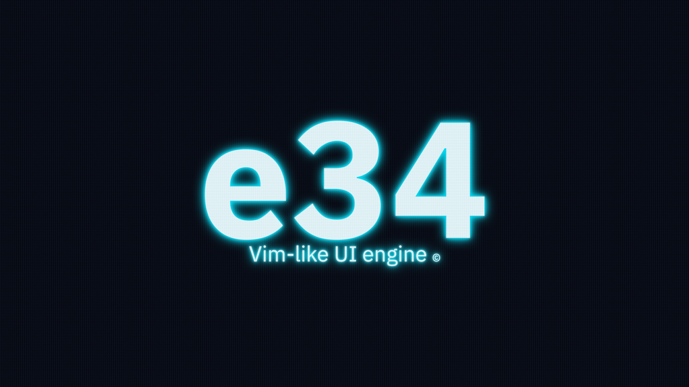
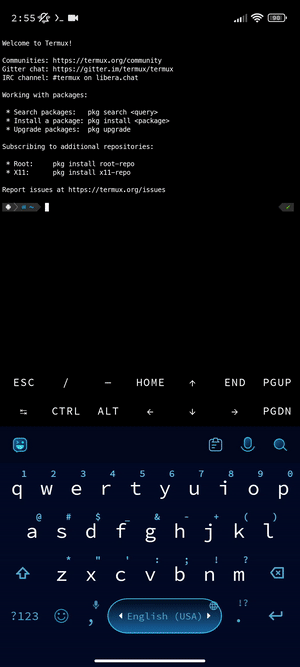

# e34

Vim-like UI engine.




## Prerequisites

The installation of prerequisites is shown for
[ArchLinux](https://archlinux.org/).

**Install the gcc package:**

```sh
sudo pacman -S gcc
```

**Install the make package:**

```sh
sudo pacman -S make
```

## Build

**Make build:**

```sh
git clone https://gitflic.ru/project/0mega3/e34.git
cd /target/e34
make
```

**Clean build (remove all compilation artifacts):**

```sh
cd /target/e34
make clean
```

## Usage

**Start the e34 ui engine:**

```sh
./e34 tui
```

**Help:**

`:help<Enter>`

## License

[BSD-3-Clause](LICENSE)

## Credits

- Denis Khorkin
